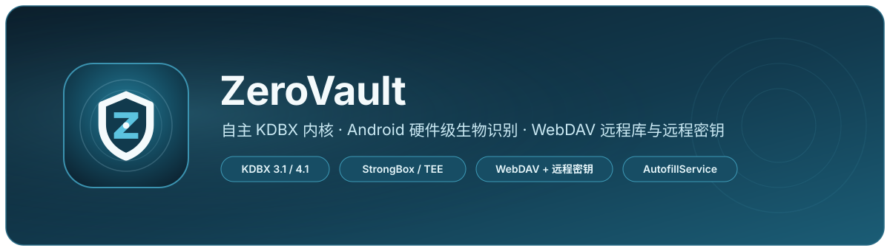
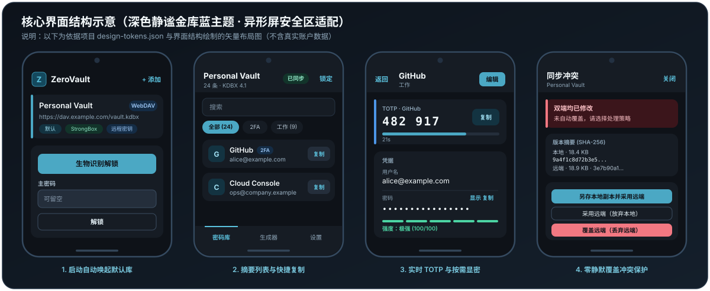
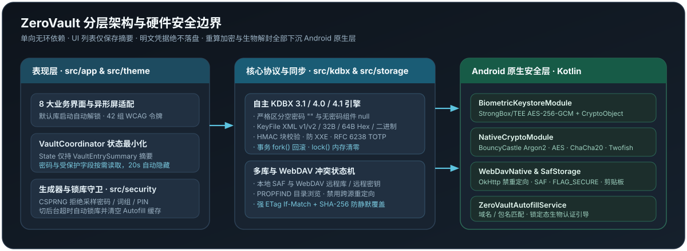
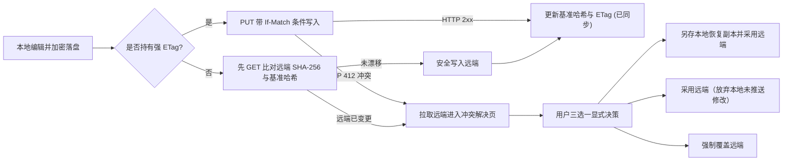

<div align="center">



<br />

[](https://github.com/zerobiubiu/ZeroVault/releases/latest)
[](https://github.com/zerobiubiu/ZeroVault/actions/workflows/ci.yml)
[](https://github.com/zerobiubiu/ZeroVault/actions/workflows/release-apk.yml)
[](LICENSE)
[-2563a8?style=flat-square)](android/build.gradle)
[](package.json)
[](bun.lock)

<p>
  <a href="#快速安装">快速安装</a> ·
  <a href="#核心能力">核心能力</a> ·
  <a href="#界面预览">界面预览</a> ·
  <a href="#系统架构与安全边界">安全架构</a> ·
  <a href="#webdav-同步与防覆盖机制">WebDAV 同步</a> ·
  <a href="#本地开发与构建">本地构建</a> ·
  <a href="#自动发布与正式签名">自动发布</a>
</p>

</div>

---

**ZeroVault** 是一款面向 Android 的开源 KeePass（`.kdbx`）密码管理器，采用 **React Native 0.88** 与 **Android 原生 Kotlin 安全模块** 构建，使用 **Bun** 作为唯一包管理器。

项目自主实现 KDBX 3.1 / 4.0 / 4.1 二进制协议内核（不引入或包装 `kdbxweb`），提供 Android 硬件级生物识别解锁（StrongBox / TEE Keystore + `BiometricPrompt` `CryptoObject`）、WebDAV 远程数据库与远程密钥文件支持、空密码与仅密钥文件完整语义，以及 Android 系统级自动填充服务（`AutofillService`）。

---

## 快速安装

前往 [GitHub Releases](https://github.com/zerobiubiu/ZeroVault/releases/latest) 下载最新的 `ZeroVault-v*-android.apk` 与 `SHA256SUMS.txt` 直接安装到 Android 7.0+ 设备：

```bash
# 下载后建议先校验 APK 完整性
sha256sum -c SHA256SUMS.txt
```

> **使用提示**
> - 启动 App 将自动唤起默认密码库解锁（支持生物识别自动弹窗、仅密钥/空密码直解，或自动聚焦主密码框）。
> - 默认开启 `FLAG_SECURE` 禁止截屏与最近任务预览，可在 **设置 → 防截屏** 按需调整。
> - 如需在其他 App 与浏览器自动填表，在 **设置 → 系统自动填充** 中一键启用 ZeroVault。

---

## 核心能力

| 能力域 | 实现要点 |
| --- | --- |
| **自主 KDBX 内核** | 独立实现 KDBX `3.1` / `4.0` / `4.1` 读写，支持 AES-256-CBC、ChaCha20、Twofish-CBC（原生层），Argon2id / Argon2d / AES-KDF，Gzip 压缩与 Salsa20 / ChaCha20 内层受保护流；防 XXE 并无损保留未知 XML 扩展字段。 |
| **完整凭据与空密码语义** | 严格区分 **仅密钥文件（`password: null`）** 与 **显式空密码（`password: ""`）**，支持 XML v1.0 / v2.0（含 4 字节校验和）/ 32B 原始 / 64B Hex / 任意二进制（含 0 字节）密钥文件，解锁时提供空密码智能兼容探测。 |
| **WebDAV 远程库与远程密钥** | 内置 Android 原生 OkHttp WebDAV 客户端，支持 `PROPFIND` 远程目录浏览选库与选远程密钥文件、同源或独立 WebDAV 认证、默认强制 HTTPS、禁用跨源重定向防凭据泄漏，以及强 ETag / SHA-256 双端冲突保护。 |
| **Android 硬件生物识别** | 基于 Android Keystore（优先 **StrongBox** 安全芯片，回退 **TEE**）生成不可导出 AES-256-GCM 密钥，强制绑定 Class 3 `BiometricPrompt` `CryptoObject` 封包解锁凭据与远程密钥；新增或变更系统生物特征时硬件自动吊销旧密钥。 |
| **系统自动填充与隐私防护** | 原生 `ZeroVaultAutofillService` 按域名与 `androidapp://` 包名匹配已解锁凭据，锁定态引导至认证页；支持 Android 13+ `EXTRA_IS_SENSITIVE` 敏感剪贴板隐藏与定时清除、切后台超时自动锁库。 |
| **TOTP 与高熵生成器** | 内置 RFC 6238 / 4226 TOTP 实时验证码（兼容 `otpauth://`、`TimeOtp-*`、`TOTP Seed`）；基于 `SecureRandom` 拒绝采样无偏差生成随机强密码、Diceware 易记词组与 PIN 码，附实时熵值评估。 |
| **异形屏适配与双色主题** | 原生 `DisplayCutout` 窗口模式与三层安全区兜底，完整适配刘海屏、挖孔屏与手势栏；42 组深浅双色语义令牌全部通过 WCAG AA 对比度自动门禁（最低 `6.11:1`）。 |

### KDBX 凭据与密钥文件兼容矩阵

| 凭据组合 | 协议语义 | 本地 SAF | WebDAV 远程库 | 生物识别硬件封包 |
| --- | --- | :---: | :---: | :---: |
| 主密码 | `password: "secret"` | 支持 | 支持 | 支持 |
| 纯空密码 | `password: ""` | 支持 | 支持 | 支持 |
| 仅密钥文件（本地 / 远程） | `password: null` + `keyFile` | 支持 | 支持 | 支持 |
| 主密码 / 空密码 + 密钥文件 | `password: string` + `keyFile` | 支持 | 支持 | 支持 |

---

## 界面预览

<div align="center">
  
</div>

---

## 系统架构与安全边界

<div align="center">
  
</div>

### 关键安全不变量

1. **零明文落盘**：主密码、派生复合密钥、远程密钥文件明文与 WebDAV 密码绝不以明文写入本地文件、偏好设置或日志；离线缓存的远程密钥与 WebDAV 凭据一律经 Android Keystore 硬件加密封包，且在 [AndroidManifest.xml](android/app/src/main/AndroidManifest.xml) 中显式关闭 `allowBackup`。
2. **界面状态最小化**：全局 React 状态仅保存 `VaultEntrySummary` 摘要（不含明文密码、受保护自定义字段与附件字节），仅在查看、复制或自动填充时按需读取，显示密码 20 秒后自动重新遮掩。
3. **原生密码学加速**：高耗时 KDF（Argon2id / Argon2d / AES-KDF）与对称加解密运行在 Android 后台协程池（BouncyCastle + `javax.crypto`），运算完毕立即擦除敏感字节缓冲，不阻塞界面渲染。
4. **事务回滚与锁库擦除**：条目编辑先通过 `fork()` 在事务副本上执行并序列化加密，写入成功后再原子替换主会话；锁库时同步清零内核字节槽位并清空原生 `AutofillSessionStore`。

---

## WebDAV 同步与防覆盖机制

本地 SAF 文件与 WebDAV 来源独立管理，任何双端版本分叉均不会静默覆盖用户数据：



---

## 目录结构

| 职责模块 | 路径 | 职责说明 |
| --- | --- | --- |
| 自主 KDBX 核心 | [src/kdbx/](src/kdbx/) | 二进制头、HMAC 块流、防 XXE XML、复合密钥、TOTP、原生与 Node 双密码学适配器 |
| 多库与 WebDAV | [src/storage/](src/storage/) | OkHttp/Fetch WebDAV 传输、`PROPFIND` 目录浏览、同步冲突状态机、硬件封包档案存储 |
| 生成器与锁库守卫 | [src/security/](src/security/) | CSPRNG 无偏差密码/词组/PIN 生成器、熵值评估、自动锁定与 Autofill 同步 |
| 原生桥接契约 | [src/native/](src/native/) | Android 原生模块 TypeScript 接口定义与安全桥接 |
| 设计令牌与主题 | [src/theme/](src/theme/) | 由 [design-tokens.json](design-tokens.json) 自动校验生成的深浅双色语义令牌 |
| 界面与状态协调 | [src/app/](src/app/) | 8 大业务界面、异形屏安全布局组件、原创 `BrandLogo` 与 `VaultCoordinator` |
| Android 原生实现 | [android/app/src/main/java/com/zerovault/app/](android/app/src/main/java/com/zerovault/app/) | Kotlin 硬件 Keystore、BouncyCastle 加密、OkHttp WebDAV、SAF 与 `AutofillService` |
| 单元测试与门禁 | [tests/](tests/) / [tools/](tools/) | Vitest 全量单测（KDBX / WebDAV / 安全）、版本门禁、WCAG 对比度校验与图标生成器 |

---

## 本地开发与构建

项目唯一包管理器为 `bun`（锁定于根 [bun.lock](bun.lock)），请勿混用 `npm`、`yarn` 或 `pnpm`。

### 环境要求

- **Bun** `>= 1.4.0` 与 **Node.js** `>= 22.11.0`
- **JDK** `21` 或 Android Studio 内置 JBR（OpenJDK 25）
- **Android SDK**：`platforms;android-37.0`、`build-tools;37.0.0`、`ndk;27.1.12297006`

### 常用命令

```bash
# 1. 安装项目依赖
bun install --frozen-lockfile

# 2. 运行全量本地门禁（版本一致性 + 42 组设计令牌 WCAG 对比度 + TypeScript + Vitest）
bun run verify:all

# 3. 单独执行静态检查或单元测试
bun run check
bun run test
```

<details>
<summary><strong>展开查看 Android Release APK 本地编译命令（Windows / macOS / Linux）</strong></summary>

#### Windows (PowerShell)

```powershell
$env:ANDROID_HOME = "$env:LOCALAPPDATA\Android\Sdk"
$env:JAVA_HOME = "C:\Program Files\Android\Android Studio\jbr"
$env:PATH = "$env:JAVA_HOME\bin;$env:ANDROID_HOME\platform-tools;$env:PATH"
cd android
.\gradlew.bat :app:assembleRelease
```

#### macOS / Linux

```bash
chmod +x android/gradlew
cd android
./gradlew :app:assembleRelease
```

构建产物位于 `android/app/build/outputs/apk/release/app-release.apk`（内嵌完整 Hermes 字节码，可脱离电脑独立安装真机；`app-debug.apk` 不内嵌 JS Bundle，仅用于连接 Metro 调试）。

</details>

---

## 自动发布与正式签名

仓库已配置两条遵循最小权限与防注入规范的 GitHub Actions 工作流：

- **持续集成**（[.github/workflows/ci.yml](.github/workflows/ci.yml)）：推送 `main` 或 PR 自动运行 `bun run verify:all`。
- **自动构建与发布 APK**（[.github/workflows/release-apk.yml](.github/workflows/release-apk.yml)）：推送 `v*` 标签（例如 `git tag -a v0.1.4 -m "Release v0.1.4" && git push origin v0.1.4`）或手动触发后，自动校验版本一致性、编译 Release APK、生成 `SHA256SUMS.txt`、提取 `CHANGELOG.md` 发布说明并推送至 [GitHub Releases](https://github.com/zerobiubiu/ZeroVault/releases)。

### 可选：配置正式 Android 签名证书

在仓库 `Settings → Secrets and variables → Actions` 配置以下 4 项 Secrets 后，Actions 将自动切换为正式证书签名（未配置时默认回退开发签名并在 Release Notes 中明确标注）：

| Secret 名称 | 说明 |
| --- | --- |
| `ANDROID_KEYSTORE_BASE64` | 正式 `.jks` / `.keystore` 文件的 Base64 编码字符串 |
| `ANDROID_KEYSTORE_PASSWORD` | Keystore 存储库密码 |
| `ANDROID_KEY_ALIAS` | 签名密钥别名 |
| `ANDROID_KEY_PASSWORD` | 密钥条目密码 |

---

## 文档导航与致谢

- [文档中心索引](docs/README.md) · [系统架构与十步规划](docs/architecture/0001-system-architecture.md) · [技术栈与安全边界决策 (ADR-0001)](docs/decisions/0001-tech-stack-and-security-boundary.md) · [设计系统手册](DESIGN.md) · [变更日志](CHANGELOG.md) · [协作规则](AGENTS.md)

**设计参考声明**：ZeroVault 在交互层次、Android 安全实践与 KDBX 防覆盖模型方面参考了 Keyguard、KeePassDX、KeePass2Android 与 KeeWeb 等优秀开源项目的公开理念；所有协议、原生模块与界面源码均为独立从零实现，未 fork 或依赖上述项目。

## 开源许可

本项目采用 [MIT License](LICENSE) 开源许可协议。
