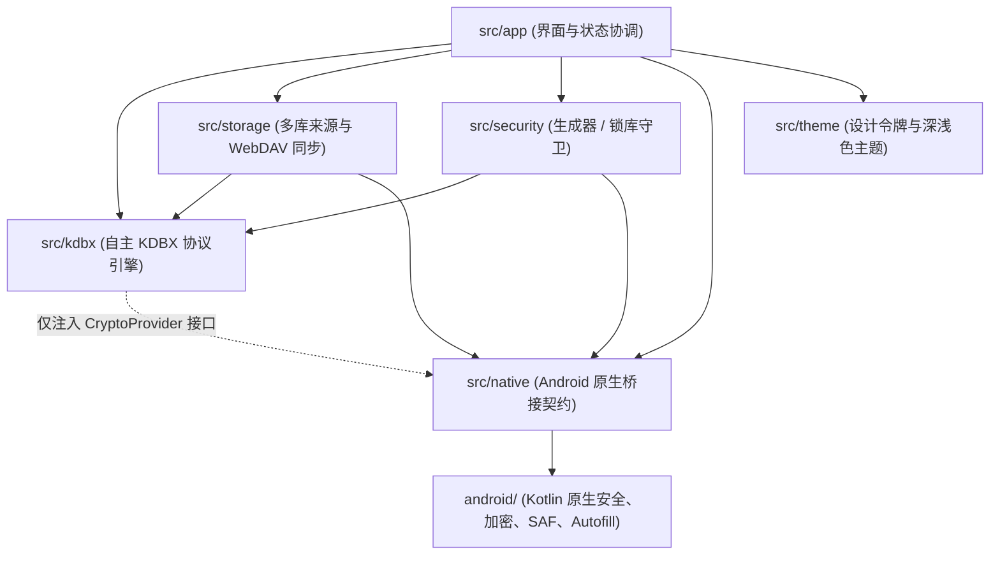

# 0001 - ZeroVault 系统架构与十步规划

- **状态**：有效
- **影响范围**：全项目（`src/`、`android/`、`tests/`、`tools/`）
- **前置文档**：无
- **替代文档**：无
- **生效版本**：`0.1.0`

---

## 1. 项目范围

ZeroVault 是面向 Android 平台的商业成熟标准 KeePass（`.kdbx`）密码管理器，采用 React Native 0.88 裸工程与 Kotlin 原生安全模块构建，使用 Bun 作为唯一包管理器。设计参考 Keyguard 的现代化 Material 3 层次交互、KeePassDX / KeePass2Android 的 Android 安全与自动填充实践以及 kdbx-web 的自主 KDBX 与防静默覆盖模型（不 fork 或依赖任何参考项目）。

### 核心参与者与外部边界

- **用户**：在 Android 手机/平板上管理个人或团队多个 KDBX 密码库。
- **本地存储（Android SAF）**：通过系统文档选择器授权的持久化本地/网盘提供者 URI。
- **WebDAV 服务端**：承载远程 `.kdbx` 数据库及可选远程密钥文件（同源或独立 WebDAV 路径）。
- **Android 系统安全模块**：Android Keystore（StrongBox / TEE）、`BiometricPrompt`（Class 3 Strong）、`AutofillService`、`ClipboardManager`、`WindowManager.LayoutParams.FLAG_SECURE`。

---

## 2. 核心用例清单

| 用例编号 | 用例名称 | 入口 | 涉及职责 | 关键边界与异常 |
| --- | --- | --- | --- | --- |
| UC-01 | 添加或创建本地 KDBX 库 | 来源向导 | `app` → `storage` → `kdbx` / `native` | SAF 权限撤销、空密码与无密码区分、文件损坏 |
| UC-02 | 连接 WebDAV 远程库与远程密钥 | 来源向导 | `app` → `storage` → `native` → `kdbx` | HTTPS 校验、401/403/404、重定向拒绝、无强 ETag、远程密钥校验失败 |
| UC-03 | 主凭据或生物识别解锁 | 解锁页 | `app` → `security` → `native` → `storage` → `kdbx` | 错误密码、空密码 `""` 与仅密钥 `null` 切换、生物特征变更致密钥失效回退 |
| UC-04 | 浏览、搜索、筛选与查看条目 | 密码库/搜索/详情页 | `app` → `kdbx` | 列表仅持摘要、按需读密码、TOTP 实时刷新、防截屏与敏感剪贴板 |
| UC-05 | 新建、编辑、删除条目与分组管理 | 编辑器/详情页 | `app` → `kdbx` → `storage` | 自动保留历史快照、回收站语义、事务 `fork()` 失败回滚 |
| UC-06 | 离线缓存与 WebDAV 双向同步/冲突解决 | 同步栏/冲突页 | `app` → `storage` → `kdbx` | 离线可编辑、远端版本漂移（412/Hash 不符）时三选一显式解决 |
| UC-07 | 强密码/词组/PIN 生成 | 生成器页/编辑器 | `app` → `security` | 密码学安全随机源（CSPRNG）、无偏差取模、熵强度分级 |
| UC-08 | Android 系统自动填充 | `ZeroVaultAutofillService` | `android/autofill` → `security` → `kdbx` | 锁态拉起生物识别认证页、包名/域名匹配、绝不跨站盲填 |
| UC-09 | 手动/超时/切后台自动锁库 | 全局守卫/设置页 | `security` → `kdbx` → `native` | 擦除 JS 缓冲与原生 Autofill 会话缓存 |

---

## 3. 核心规则与唯一权威归属

| 规则域 | 核心规则 | 唯一权威归属 | 执行位置 | 验证方式 |
| --- | --- | --- | --- | --- |
| KDBX 凭据与密钥派生 | `password: null`（无密码组件）与 `password: ""`（空密码组件）互不替代；XML v1/v2(含校验和)/32B/64B Hex/任意二进制密钥解析 | `src/kdbx/credentials.ts` | `src/kdbx/vault.ts` | `tests/kdbx/credentials.test.ts` |
| KDBX 3.1/4.x 协议与完整性 | 头哈希、HMAC-SHA256 块链校验、InnerRandomStream 解密、XXE 禁用、未知 XML 字段/附件无损保留 | `src/kdbx/header.ts`, `xml.ts`, `vault.ts` | `src/kdbx/vault.ts` | `tests/kdbx/vault.test.ts` |
| TOTP 解析与计算 | RFC 6238/4226，`otpauth://`、KeePass 2.x `TimeOtp-*` 与 `TOTP Seed/Settings` 兼容解析 | `src/kdbx/totp.ts` | 详情页 | `tests/kdbx/totp.test.ts` |
| WebDAV 传输与防覆盖 | 默认强制 HTTPS（显式放行局域网配置除外）、拒绝跨源重定向、强 ETag `If-Match` 条件写入、SHA-256 内容版本对比 | `src/storage/webdav.ts`, `sync-engine.ts` | `src/storage/sync-engine.ts` | `tests/storage/webdav.test.ts`, `sync-engine.test.ts` |
| 硬件密钥封包与生物识别 | StrongBox/TEE AES-256-GCM 密钥绑定 `BiometricPrompt` `CryptoObject`，新增生物特征自动失效 | `android/.../security/BiometricKeystoreModule.kt` | `src/native/bridge.ts` | Android 原生构建与设备验证 |
| 密码生成与强度评估 | CSPRNG 无偏差生成、熵值计算、常见弱密码/模式识别 | `src/security/generator.ts` | 生成器与详情/编辑页 | `tests/security/security.test.ts` |
| 视觉令牌与对比度 | 原始色阶 + 语义令牌双层结构，深浅色模式文本对比度 ≥ 4.5:1（大字 ≥ 3:1） | `design-tokens.json` → `src/theme/tokens.ts` | 全部 `src/app/` 组件 | `tools/verify-tokens.mts` |

---

## 4. 职责单元与依赖方向

- **单向无环**：`src/kdbx` 与 `src/theme` 为最底层零业务依赖模块；`src/kdbx` 通过 `CryptoProvider` 依赖倒置接入原生加密加速，使得全部 KDBX 协议逻辑可在 Node/Vitest 下脱离 Android 独立运行测试。
- **跨职责门面**：外部只从各模块根目录 `index.ts` 导入，不跨越边界访问内部实现文件。

---

## 5. 变更场景模拟与局部性验收

| 变更场景 | 目标职责 | 必要修改范围 | 附带修改 | 测试范围 | 局部性结论 |
| --- | --- | --- | --- | --- | --- |
| 1. 修改核心规则（如新增 KDBX 4.x 新 KDF 参数校验） | `src/kdbx` | `src/kdbx/header.ts`、`types.ts` | 无 | `tests/kdbx/` | 高度局部，不波及存储与 UI |
| 2. 新增用例（如增加 WebDAV 远程密钥自定义 Header） | `src/storage` + `src/app/screens/SourceSetupScreen` | `webdav.ts`、`types.ts`、来源表单 | 无 | `tests/storage/` | 仅限于传输配置与表单 |
| 3. 替换底层技术（如将 BouncyCastle Argon2 换成 Rust JNI） | `android/.../crypto` | `NativeCryptoModule.kt` 内部实现 | 无（TS 层 `CryptoProvider` 契约不变） | Android 原生测试 + `tests/kdbx/` | 接口隔离彻底 |
| 4. 修改数据结构（如条目新增 Passkey 自定义属性展示） | `src/kdbx` + `src/app/screens/EntryDetailScreen` | `vault.ts`、`types.ts`、详情展示组件 | 无 | `tests/kdbx/` | XML 透传机制确保旧数据无损 |
| 5. 修改 UI 交互与配色（如调整深色表面对比度） | `src/theme` | `design-tokens.json` → `tokens.ts` | 无（业务组件只引用语义令牌） | `tools/verify-tokens.mts` | 单点修改全应用生效 |
| 6. 新增独立功能（如新增 Passphrase 自定义词表） | `src/security` | `generator.ts` + 生成器页选项 | 无 | `tests/security/security.test.ts` | 规则高内聚，无跨模块扩散 |
